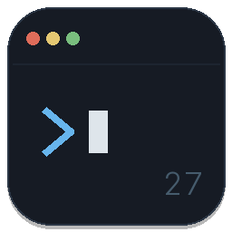
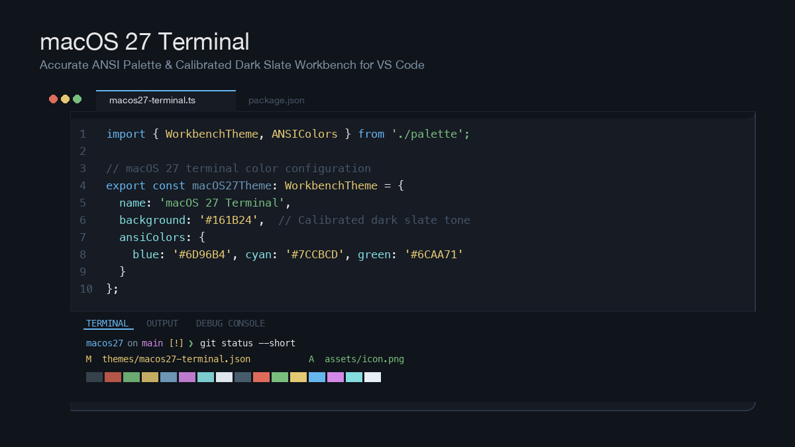

<p align="center">
  
</p>

<h1 align="center">macOS 27 Terminal Theme</h1>

<p align="center">
  A clean, authentic VS Code theme faithful to the appearance and official ANSI color palette of the <b>macOS 27 Terminal</b>.
</p>

<p align="center">
  <a href="https://marketplace.visualstudio.com/items?itemName=lainet.macos27-terminal-theme"></a>
  <a href="https://marketplace.visualstudio.com/items?itemName=lainet.macos27-terminal-theme"></a>
  <a href="LICENSE"></a>
</p>



---

## Features

- **Accurate Dark Slate Tone (`#161B24`)**: Calibrated backdrop and workbench chrome reproducing the translucent-composited appearance of the macOS 27 Terminal.
- **Authentic ANSI Syntax Mapping**: Every token maps directly to calibrated terminal ANSI colors for consistent visual hierarchy across your editor and integrated terminal.
- **Bracket Pair Colorization**: Native multi-level bracket highlighting using harmonious ANSI accents.
- **Semantic Highlighting**: Full support for language server semantic tokens in TypeScript, Python, Go, Rust, and C++.
- **Integrated Terminal Harmony**: Terminal colors match the theme's syntax colors seamlessly.

---

## Color Palette

| Color | Normal ANSI | Hex | Bright ANSI | Hex | Typical Role |
| :--- | :--- | :--- | :--- | :--- | :--- |
| **Black** | `ansiBlack` | `#35424C` | `ansiBrightBlack` | `#465C6D` | Comments, Line Numbers, UI Borders |
| **Red** | `ansiRed` | `#B45648` | `ansiBrightRed` | `#DF6C5A` | Errors, Destructuring, Deletions |
| **Green** | `ansiGreen` | `#6CAA71` | `ansiBrightGreen` | `#79BE7E` | Strings, Git additions, Success |
| **Yellow** | `ansiYellow` | `#C4AC62` | `ansiBrightYellow` | `#E5C872` | Types, Classes, Escape characters |
| **Blue** | `ansiBlue` | `#6D96B4` | `ansiBrightBlue` | `#67B5ED` | Functions, Methods, Active UI accents |
| **Magenta** | `ansiMagenta` | `#BD7BCD` | `ansiBrightMagenta` | `#D389E5` | Keywords, Storage, Control flow |
| **Cyan** | `ansiCyan` | `#7CCBCD` | `ansiBrightCyan` | `#84DDE0` | Constants, Numbers, Regex |
| **White** | `ansiWhite` | `#DEE5EB` | `ansiBrightWhite` | `#E5EFF5` | Foregrounds, Variables, Cursor |

---

## Recommended Settings

For the most authentic macOS Terminal experience, add these settings to your `settings.json`:

```json
{
  "workbench.colorTheme": "macOS 27 Terminal",
  "editor.fontFamily": "'SF Mono', 'Menlo', 'Cascadia Code', monospace",
  "editor.fontSize": 13,
  "editor.lineHeight": 1.6,
  "editor.bracketPairColorization.enabled": true,
  "editor.guides.bracketPairs": "active",
  "terminal.integrated.fontFamily": "'SF Mono', 'Menlo', monospace"
}
```

---

## Installation

### From VS Code Marketplace
1. Open **Extensions** in VS Code (`Cmd + Shift + X`).
2. Search for **`macOS 27 Terminal Theme`**.
3. Click **Install**.
4. Open the Command Palette (`Cmd + Shift + P`), type **Preferences: Color Theme**, and select **macOS 27 Terminal**.

### Manual Installation (.vsix)
```bash
# Package the extension
npx @vscode/vsce package

# Install into VS Code
code --install-extension macos27-terminal-theme-1.1.0.vsix
```

---

## Development & Contributing

1. Clone the repository:
   ```bash
   git clone https://github.com/lainet/macos27-terminal-theme.git
   cd macos27-terminal-theme
   ```
2. Open in VS Code:
   ```bash
   code .
   ```
3. Press **`F5`** to launch an Extension Development Host window with the theme loaded.
4. Modify `themes/macos27-terminal.json` to see live updates.

---

## License

[MIT](LICENSE) © [lainet](https://github.com/lainet)
